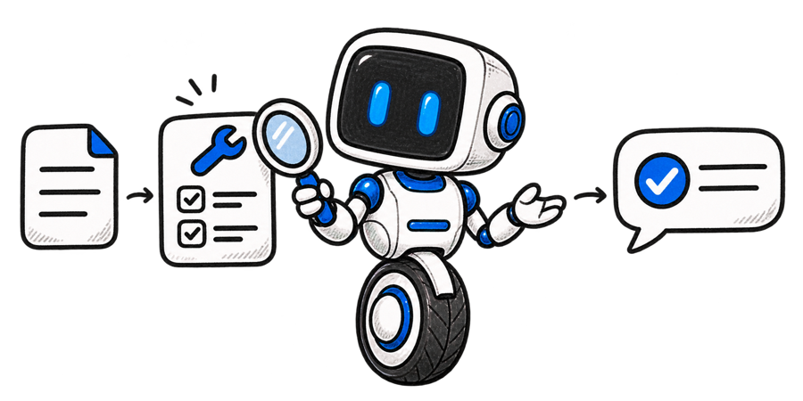

<p align="center">
  
</p>

<h1 align="center">Laravel Agent Sidebar</h1>

<p align="center">Aggiungi alla tua app Laravel un assistente che conosce la pagina aperta, consulta i dati autorizzati e ritrova la conversazione al prossimo accesso.</p>

<p align="center">
  <a href="#installazione">Installazione</a> ·
  <a href="#configurazione">Configurazione</a> ·
  <a href="#tool-e-fonti">Tool e fonti</a> ·
  <a href="#server-mcp-esterni">MCP</a> ·
  <a href="#task-pact">PACT</a> ·
  <a href="#api-json">API</a>
</p>

<p align="center">
  
</p>

Il pacchetto fornisce le API Laravel, la cronologia sul server e il collegamento al modello tramite Laravel AI. L’app ospite decide dove appare l’assistente, quale modello usa e quali letture può eseguire. Puoi adattare gli esempi Blade e Inertia/React oppure costruire il frontend con i componenti del tuo progetto. [Esempi di integrazione](examples)

- **Contesto della pagina.** L’app passa un token temporaneo al frontend. Il server risolve di nuovo utente, spazio e risorsa quando riceve la domanda.
- **Una conversazione per utente e spazio.** La cronologia segue l’utente fra le pagine abilitate e si ritrova dopo un ricaricamento o un nuovo accesso.
- **Risposte con fonti.** L’agente usa i tool di sola lettura registrati dall’app e può citare le risorse consultate. L’app verifica l’accesso anche quando riapre la cronologia.
- **Integrazioni opzionali.** Memoria breve, Wiki privata cifrata, tool MCP esterni e task in ingresso tramite PACT.

<p align="center">
  
</p>

## Installazione

Serve **PHP 8.3–8.5** con **Laravel 12.62+ nella serie 12** oppure **Laravel 13.15+ nella serie 13**. L’app deve avere autenticazione web e una `APP_KEY` configurata. Composer installa anche `laravel/ai:^1.4.1`. [Manifest Composer](composer.json) · [Matrice CI](.github/workflows/agent-sidebar.yml)

Esegui questi comandi dalla directory dell’app Laravel.

```sh
composer config repositories.agent-sidebar vcs https://github.com/padosoft/laravel-agent-sidebar
composer require "padosoft/laravel-agent-sidebar:^0.2"
php artisan vendor:publish --tag=agent-sidebar-config
php artisan vendor:publish --tag=agent-sidebar-migrations
php artisan migrate
```

### Prima risposta in Blade

**1. Configura il modello.** Scegli un modello che supporti le chiamate ai tool e possa rispondere in JSON. Questo esempio usa OpenAI e va nel `.env`.

```dotenv
AGENT_SIDEBAR_PROVIDER=openai
AGENT_SIDEBAR_MODEL=gpt-6.1-sol
OPENAI_API_KEY=
```

Compila `OPENAI_API_KEY` con la chiave dell’app. Per un altro provider, usa il suo nome in Laravel AI e le relative credenziali. Se l’app usa la cache della configurazione, aggiornala dopo le modifiche. [Configurazione dei provider Laravel AI](https://laravel.com/docs/13.x/ai-sdk#configuration)

**2. Abilita una pagina e le API.** In `config/agent-sidebar.php` imposta `'pages' => ['orders.index' => 'Ordini']`. Aggiungi queste route in `routes/web.php` per esporre le API e passare il contesto alla vista.

```php
use Illuminate\Http\Request;
use Illuminate\Support\Facades\Route;
use Padosoft\AgentSidebar\AgentSidebar;
use Padosoft\AgentSidebar\PageContext;

AgentSidebar::routes();

Route::get('/ordini', function (Request $request) {
    return view('orders.index', [
        'assistant' => app(PageContext::class)->share($request),
    ]);
})->middleware('auth')->name('orders.index');
```

**3. Monta il pannello.** Trovi gli esempi in `vendor/padosoft/laravel-agent-sidebar/examples`. Copia `sidebar.blade.php` in `resources/views/partials` e `sidebar-client.ts` e `blade-sidebar.ts` in `resources/js`. Aggiungi `import './blade-sidebar';` all’entrypoint Vite caricato dal layout e `<meta name="csrf-token" content="{{ csrf_token() }}">` al suo `<head>`. [Partial Blade](examples/sidebar.blade.php) · [Client HTTP](examples/sidebar-client.ts) · [Collegamento Blade](examples/blade-sidebar.ts)

Crea `resources/views/orders/index.blade.php` usando il layout dell’app e includi il pannello quando la pagina ha un contesto valido.

```blade
@if ($assistant ?? null)
    @include('partials.sidebar')
@endif
```

Con gli asset Vite disponibili, apri `/ordini` da autenticato su HTTPS. Chiedi «Su quale pagina mi trovo?» e ricarica la pagina. Il pannello mostra la risposta salvata. In questo esempio il modello riceve l’etichetta «Ordini». Per consultare gli ordini effettivi registra un tool con le policy dell’app.

### Inertia, React o un frontend tuo

Copia `WorkspaceSidebar.tsx` e `sidebar-client.ts` nella stessa cartella e adatta gli import di `Button` e `Dialog` ai componenti dell’app. Aggiungi questa prop all’array restituito da `HandleInertiaRequests::share()`.

```php
'sidebarAssistant' => function () use ($request): ?array {
    $pages = app(\Padosoft\AgentSidebar\PageContext::class);
    $context = $pages->share($request);
    $subject = $pages->subject($request);

    if ($context === null || $subject === null) {
        return null;
    }

    return [
        ...$context,
        'sessionUrl' => route('agent-sidebar.session.show', absolute: false),
        'identity' => $subject->actorKey.':'.$subject->scopeKey,
    ];
},
```

Monta `<WorkspaceSidebar assistant={sidebarAssistant} />` nel layout persistente e aggiungi il meta tag CSRF al documento. `identity` fa ricreare il pannello quando cambia l’utente o lo spazio. Nella stessa conversazione, ogni pagina può fornire un token aggiornato. Per costruire il tuo frontend puoi riusare il client TypeScript o chiamare direttamente le [API JSON](#api-json). [Componente React](examples/WorkspaceSidebar.tsx) · [Client HTTP](examples/sidebar-client.ts)

### Prefissi di route e tabelle

Il montaggio predefinito usa **`/agent-sidebar/v1`** negli URL e **`agent-sidebar.`** nei nomi delle route. Riserva questi prefissi al pacchetto. Per montarlo in un’area dell’app, usa un gruppo Laravel come questo.

```php
Route::prefix('admin')->name('admin.')->group(function (): void {
    AgentSidebar::routes();
});
```

La sessione risponde su `/admin/agent-sidebar/v1/session` e la route si chiama `admin.agent-sidebar.session.show`. Usa questo nome anche nel partial Blade o per generare la prop `sessionUrl`. `AgentSidebar::routes($prefix, $name)` accetta anche prefissi espliciti. Il fallback ai prefissi del pacchetto per gli argomenti vuoti e il percorso `/` è disponibile nelle revisioni successive al tag `v0.2.0`. [Registrazione delle route](src/AgentSidebar.php)

| Tabella | Contenuto |
| --- | --- |
| `agent_sidebar_sessions` | La sessione corrente della coppia utente e spazio, con UUID pubblico e stato della memoria. |
| `agent_sidebar_turns` | Domanda, risposta, stato, scadenza e riferimenti alle fonti di ogni invio. |
| `agent_sidebar_memory` | Valori di contesto, riassunto breve e riferimenti alle sezioni della Wiki. |
| `agent_sidebar_wiki_files` | Disco, percorso e stato dei file cifrati della Wiki. |

Le domande, le risposte e le dipendenze dalle fonti sono cifrate con la chiave Laravel. I turni sono univoci per sessione e UUID di invio. Lo schema è contenuto nelle due migrazioni del pacchetto. [Migrazione delle conversazioni](database/migrations/2026_11_23_000001_create_agent_sidebar_tables.php) · [Migrazione della memoria](database/migrations/2026_11_24_000001_add_memory_to_agent_sidebar.php)

## Come funziona un turno

Un turno comprende la domanda, lo stato dell’elaborazione e l’eventuale risposta. Il server controlla il token di pagina, salva il turno e chiama il modello con il contesto, la cronologia utilizzabile e i tool consentiti. Quando il modello chiede una lettura, il pacchetto convalida gli argomenti e l’app applica le sue policy. Prima di salvare la risposta, il pacchetto verifica di nuovo le fonti.

<p align="center">
  
</p>

Il POST esegue la generazione in modo sincrono. Una conversazione può avere un solo turno in elaborazione. Se la connessione cade, puoi cercare il turno per UUID o reinviare la stessa domanda con lo stesso UUID. Alla scadenza, il turno passa a `failed` e una risposta tardiva viene scartata. [Gestione dei turni](src/Conversations.php) · [Esecuzione dell’agente](src/TurnRunner.php)

## Configurazione

Il file pubblicato è [`config/agent-sidebar.php`](config/agent-sidebar.php). Queste sono le opzioni da cui partire.

| Chiave | Impostazione di fabbrica |
| --- | --- |
| `pages`, `host` | Elenco di pagine vuoto. `ApplicationHost` usa le etichette configurate e considera l’intera applicazione uno spazio. |
| `tools`, `require_tool` | Registro vuoto. Con `require_tool` attivo e tool disponibili, il modello deve chiamarne uno al primo passaggio. |
| `instructions` | Istruzioni da adattare al dominio e alla lingua dell’app. |
| `provider`, `model` | Leggono `AGENT_SIDEBAR_PROVIDER` e `AGENT_SIDEBAR_MODEL`. Laravel AI fornisce i valori di ripiego. |
| `context_ttl`, `turn_ttl`, `inference_timeout` | Token di pagina di 1.800 s, turno di 90 s e timeout di inferenza di 25 s. Il timeout di inferenza è limitato dalla durata del turno. |
| `requests_per_minute` | 12 nuovi turni al minuto per utente e spazio. |
| `memory`, `wiki`, `mcp_servers`, `pact` | Memoria e PACT disattivati, disco Wiki `local`, elenco server MCP vuoto. |

Ogni turno usa al massimo tre passaggi del modello e sei chiamate ai tool. La domanda accetta fino a 3.000 caratteri e la risposta fino a 6.000. Con la memoria disattivata, il modello riceve fino a quattro turni completati le cui fonti sono ancora valide. [Limiti dell’agente](src/SidebarAgent.php) · [Contesto del turno](src/TurnContext.php)

### Quale modello viene chiamato

Il motore sceglie provider e modello dalla prima configurazione applicabile.

1. Override del singolo turno in PHP con `TurnBuilder::usingModel()`, oppure modello fornito in `AuthorizedRun` per PACT.
2. Risultato del resolver configurato tramite `resolveModelUsing()`. Il resolver riceve il `Subject` e restituisce una `ModelSelection` oppure `null`.
3. Default impostato con `AgentSidebar::configure()->usingModel(...)->register()`.
4. Valori del file `config/agent-sidebar.php`.

Per i valori omessi nella selezione risultante, Laravel AI usa `ai.default` per il provider e il modello di testo del provider. Usa `php artisan vendor:publish --tag=ai-config` per pubblicare `config/ai.php` se vuoi personalizzare i default o definire un provider nominativo. Registra le opzioni fluenti in un service provider caricato anche nei worker. [Risoluzione del modello](src/ModelSelection.php) · [Configurazione fluente](src/SidebarConfiguration.php)

## Tool e fonti

Per collegare i dati dell’app, implementa una classe `ReadTool`. `name()` assegna un nome univoco, `description()` indica al modello quando usarla, `schema()` dichiara gli argomenti e `rules()` li valida. Ogni campo dello schema richiede una regola Laravel.

Nel file `config/agent-sidebar.php`, aggiungi la classe del progetto alla voce `tools`.

```php
'tools' => [
    \App\AgentTools\ReadOrder::class,
],
```

Se registri i tool da un service provider, usa `AgentSidebar::configure()->withTools(ReadOrder::class)->register()`. File di configurazione e API fluente alimentano lo stesso registro. Registra ogni classe una sola volta.

In `read(Subject $subject, array $arguments)`, usa `$subject->actor` e `$subject->scope` con i servizi e le policy già usati dall’app. Restituisci un `ToolResult` con il testo necessario al modello e gli ID di tutte le risorse riservate consultate, incluse quelle che contribuiscono a un riepilogo.

Se l’app ha più spazi o il tool consulta dati riservati, imposta in `host` una classe applicativa che implementa il contratto `Host`.

- `scope()` ricava dalla richiesta lo spazio autorizzato, oppure restituisce `null` per negare l’accesso.
- `page()` verifica la route e le risorse e restituisce un `Page` con etichetta, riepilogo e ID delle fonti.
- `sources()` risolve gli ID ancora visibili in oggetti `Source`, con titolo, percorso locale e revisione. Aggiorna la revisione quando una modifica deve invalidare le risposte salvate che dipendono dalla risorsa.
- Per esporre singoli tool in base a utente, spazio o canale, l’host può implementare anche `ToolAuthorization`.

Il modello può citare le fonti della pagina e dei tool usati nel turno. L’API rende indisponibile una risposta salvata quando l’utente perde accesso a una fonte o la sua revisione cambia. [Contratto del tool](src/Contracts/ReadTool.php) · [Tool di esempio](tests/ReadOrder.php) · [Host con più spazi](tests/TestHost.php)

<p align="center">
  
</p>

## Memoria

La cronologia è disponibile anche con la memoria disattivata. Per attivare il riassunto breve, la Wiki privata e il loro aggiornamento in coda, registra le opzioni in un service provider.

```php
use Padosoft\AgentSidebar\AgentSidebar;
use Padosoft\AgentSidebar\MemoryOptions;

AgentSidebar::configure()
    ->withMemory(MemoryOptions::make()
        ->wikiSections(['preferences', 'decisions'])
        ->automatic(WorkspaceMemoryAuthorization::class))
    ->register();
```

`WorkspaceMemoryAuthorization` è una classe dell’app che implementa `MemoryAuthorization`. Cattura un riferimento temporaneo all’autorizzazione e, nel worker, ricontrolla identità, spazio e destinazione dei dati. Il worker usa la selezione del modello del turno. Puoi indicare una destinazione dedicata con `MemoryOptions::usingModel()`, previa verifica da parte dell’host. [Contratto della memoria](src/Contracts/MemoryAuthorization.php)

- **Prompt.** I budget iniziali sono 2.000 token di cronologia recente, 700 di riassunto breve e 500 di riepilogo della Wiki. `countingTokensUsing()` accetta un contatore specifico. Il fallback stima il costo per byte UTF-8 e aggiunge un costo fisso per coppia di messaggi.
- **Storage e coda.** Usa un disco Laravel privato per `AGENT_SIDEBAR_WIKI_DISK` e tieni configurati i dischi che ospitano file esistenti. Configura una connessione asincrona in `AGENT_SIDEBAR_MEMORY_QUEUE` oppure usa quella predefinita dell’app e avvia `php artisan queue:work` sulla connessione scelta. Esegui lo scheduler Laravel ogni minuto per recuperare i job in sospeso e completare la pulizia dei file.
- **API PHP.** Su una richiesta autenticata, `AgentSidebar::forRequest($request)` espone `context()`, `shortTerm()`, `longTerm()` e `turn()`. Usa `ContextValue` per associare testo e ID di fonti. `turn()->submit()` richiede UUID di invio e token pagina, come l’API JSON. [Accesso PHP](src/SidebarAccess.php) · [Invio di un turno](src/TurnBuilder.php)
- **Reset ed eliminazione.** «Nuova chat» svuota cronologia, contesto di sessione e riassunto breve e genera un nuovo ID pubblico. La Wiki e il suo riepilogo restano disponibili. Per cancellare i dati di un account o di uno spazio, usa rispettivamente `Conversations::forgetActor($actor)` e `Conversations::forgetScope($scope)`. Lo scheduler rimuove i file revocati.

Per esempio, da un’azione applicativa autenticata puoi ricordare una preferenza in una sezione della Wiki abilitata per l’agente.

```php
use Padosoft\AgentSidebar\AgentSidebar;
use Padosoft\AgentSidebar\ContextValue;

$wiki = AgentSidebar::forRequest($request)->longTerm();
$wiki->section('preferences')->put(new ContextValue('Preferisce risposte concise.'));
```

## Server MCP esterni

Installa il client con `composer require laravel/mcp`. Implementa un adattatore `McpServer` per ogni server HTTP e registralo in `mcp_servers` oppure in un service provider.

```php
use Padosoft\AgentSidebar\AgentSidebar;

AgentSidebar::configure()
    ->withMcpServer(DocumentServer::class)
    ->register();
```

L’adattatore dichiara in `tools()` i tool remoti di sola lettura con schema e regole. `allows()` controlla utente, spazio e canale. `client()` fornisce il client HTTP autenticato dal backend. `mapResult()` restituisce un `ToolResult` e include gli ID delle fonti per i risultati riservati. Un tool remoto `lookup` sul server `documents` è esposto all’agente come `mcp_documents_lookup`. [Contratto MCP](src/Mcp/McpServer.php) · [Definizione dei tool MCP](src/Mcp/McpToolDefinition.php)

## Task PACT

La sidebar web e i task PACT condividono il motore dell’agente. Una richiesta PACT porta il contesto del task, una selezione di modello se prevista e il sottoinsieme di tool autorizzati. La cronologia e la Wiki della sidebar appartengono alla sessione web.

1. Installa `pact-protocol/laravel:^0.2` e configura il trasporto PACT Core 0.2 nell’app.
2. Registra `Padosoft\AgentSidebar\Pact\PactAgentHandler` come handler del contratto `pact.agent.chat.v1` nel trasporto. Abilita `agent-sidebar.pact.enabled` e indica la classe applicativa `PactAuthorization` in `agent-sidebar.pact.authorizer`.
3. L’autorizzatore verifica i grant del task e ne acquisisce l’invocazione nel checkpoint del trasporto prima della prima chiamata al modello. Passa al motore un `AuthorizedRun` con lo scope, le verifiche correnti e la selezione dei tool. Per un budget coordinato, `beforeStep` può riservare ogni passaggio con una chiave stabile basata su task, invocazione e numero del passaggio. Se la riserva viene rifiutata, il callback interrompe il turno sollevando un errore.

Il trasporto gestisce stato, consegna e richieste di chiarimento. Un trasporto applicativo equivalente può usare direttamente `TurnRunner::runTask()`. [Handler PACT](src/Pact/PactAgentHandler.php) · [Autorizzazione PACT](src/Pact/PactAuthorization.php)

## API JSON

I percorsi della tabella sono relativi a `/agent-sidebar/v1`. Le richieste usano la sessione web autenticata e la stessa origine dell’app. Invia `Accept: application/json`, usa `Content-Type: application/json` per il corpo del `POST` e passa il token CSRF in `X-CSRF-TOKEN` per `POST` e `DELETE`. Le risposte delle API sono private e usano `Cache-Control: private, no-store`.

| Metodo | Percorso | Risposta |
| --- | --- | --- |
| `GET` | `/session?before={next_cursor}` | `session_id`, fino a 20 turni ordinati dal più vecchio al più recente e `next_cursor` per la pagina precedente. Il cursore è facoltativo. |
| `POST` | `/session/turns` | Accetta `message`, `client_message_id` UUID, `context_token` e `session_id` (inizialmente `null`). Restituisce `session_id` e `turn`. |
| `GET` | `/session/turns/{client_message_id}` | Recupera un invio per UUID dalla conversazione corrente. |
| `DELETE` | `/session/{session_id}` | Azzera la chat e restituisce `204`. Rileggi la sessione prima del prossimo invio. |

Un turno espone `id`, `message`, `status`, `available`, `answer`, `sources`, `error_code` e `created_at`. Ogni fonte espone `id`, `title` e `url`. Mostra domanda e risposta come testo e gestisci `available: false` come risposta indisponibile.

| Esito | Cosa fa il client |
| --- | --- |
| `201` | La domanda è nuova. Leggi `turn.status` per distinguere `processing`, `completed` e `failed`. |
| `200` o `202` al reinvio | Lo stesso UUID identifica un turno concluso o ancora in elaborazione. |
| `409` | Ricarica la sessione. Il codice distingue `session_changed`, `turn_in_progress` e `message_id_reused`. |
| `422` | Correggi i campi oppure ricarica il contesto se il token è scaduto. |
| `429` | Attendi il tempo indicato da `Retry-After`. |
| `turn.status = failed` | Mostra l’errore del turno. Per un nuovo tentativo esplicito genera un nuovo UUID. |

[Controller HTTP](src/SidebarController.php) · [Client TypeScript](examples/sidebar-client.ts)

## Aggiornamento dalla 0.1

Dopo l’aggiornamento della dipendenza alla serie 0.2, pubblica le migrazioni con `php artisan vendor:publish --tag=agent-sidebar-migrations` ed esegui `php artisan migrate`. La migrazione della memoria aggiunge colonne alla tabella delle sessioni e crea le due tabelle dedicate. La 0.2 legge le conversazioni della 0.1 con le API v1. Se hai pubblicato la configurazione precedente, integra le chiavi nuove nel tuo file applicativo. [Configurazione distribuita](config/agent-sidebar.php)

| Tag | Contenuto |
| --- | --- |
| [`v0.2.0`](https://github.com/padosoft/laravel-agent-sidebar/tree/v0.2.0) | API fluente, memoria, Wiki, MCP esterno e PACT in ingresso. |
| [`v0.1.0`](https://github.com/padosoft/laravel-agent-sidebar/tree/v0.1.0) | Conversazione persistente, contesto della pagina, tool di lettura e fonti. |

## Test e licenza

Esegui i test dalla directory del pacchetto.

```sh
composer install
composer test
```

La suite usa SQLite e risposte AI simulate. Per il test separato con un modello già presente in Ollama, esegui `AGENT_SIDEBAR_SMOKE_MODEL=qwen3.5:9b vendor/bin/phpunit --group live`. Il test usa un ordine fittizio.

Distribuito con licenza [MIT](LICENSE).
