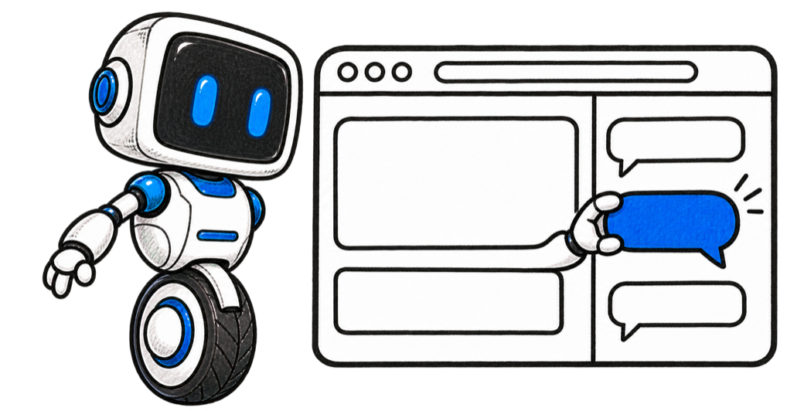
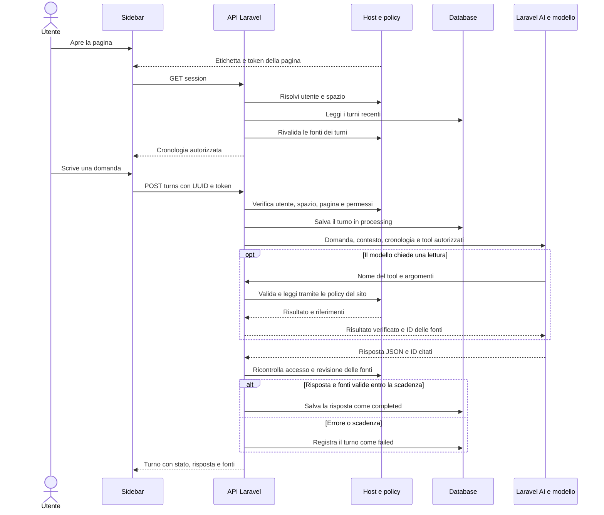

<p align="center">
  
</p>

<h1 align="center">Laravel Agent Sidebar</h1>

<p align="center">Aggiungi al tuo sito Laravel un assistente che consulta i tool del progetto e ritrova la conversazione alla prossima apertura.</p>

<p align="center">
  <a href="https://github.com/padosoft/laravel-agent-sidebar/tree/v0.1.0">Versione 0.1 · v0.1.0</a>
  · <a href="#installazione">Installazione</a>
  · <a href="#flusso-di-un-turno">Flusso</a>
  · <a href="#funzioni-disponibili">Funzioni</a>
</p>

<p align="center">
  
</p>

## Cosa offre la versione 0.1

**Laravel Agent Sidebar** è il backend di un assistente contestuale. Il pacchetto fornisce due tabelle, quattro API JSON e il collegamento a [Laravel AI](https://laravel.com/docs/13.x/ai-sdk). L’applicazione ospite sceglie le pagine su cui attivarlo, il provider, i tool e il modo in cui la sidebar appare.

| Funzione | Comportamento nella 0.1 |
| --- | --- |
| Sidebar nel layout | Montaggio sulle pagine scelte dal sito. Esempi copiabili per [Blade](examples/sidebar.blade.php) e [Inertia/React](examples/TixoraSidebar.tsx). |
| Conversazione persistente | Una cronologia per utente e spazio, disponibile dopo ricaricamento, cambio pagina e nuovo accesso. Nei siti senza tenant lo spazio è l’applicazione. |
| Contesto della pagina | Il server genera un token temporaneo per la route corrente. Al momento dell’invio ricostruisce il contesto autorizzato. |
| Tool applicativi | Il modello può chiedere una lettura tra i tool registrati. Il server valida gli argomenti e il tool riusa servizi e policy del sito. Le bozze rimangono nella chat. |
| Fonti verificabili | La risposta può includere link a fonti consultate e ancora visibili. Il pacchetto ricontrolla accesso e revisione prima di mostrare o riusare una risposta salvata. |
| Invii ripetuti e recupero | Un UUID identifica ogni invio. La stessa richiesta recupera il turno esistente. Un solo turno per conversazione può essere in elaborazione. |
| Azzeramento e cancellazione | «Nuova chat» elimina i turni e ruota l’identificativo pubblico. Il sito può cancellare le conversazioni di un account o di uno spazio. |

<p align="center">
  
</p>

## Installazione

Serve un’app con **PHP 8.3–8.5**, **Laravel 12.62+ o 13.15+**, autenticazione web e una chiave Laravel `APP_KEY` configurata. Composer installa `laravel/ai:^1.4.1` come dipendenza.

```sh
composer config repositories.agent-sidebar vcs https://github.com/padosoft/laravel-agent-sidebar
composer require "padosoft/laravel-agent-sidebar:^0.1"
php artisan vendor:publish --tag=agent-sidebar-config
php artisan vendor:publish --tag=agent-sidebar-migrations
php artisan migrate
```

Scegli un provider con supporto ai tool e un modello capace di rispondere in JSON. Imposta `AGENT_SIDEBAR_PROVIDER` e `AGENT_SIDEBAR_MODEL` e configura le credenziali secondo la [guida Laravel AI](https://laravel.com/docs/13.x/ai-sdk#configuration). Per pubblicare la configurazione del solo SDK usa `php artisan vendor:publish --tag=ai-config`. Il tag `agent-sidebar-migrations` contiene tutto lo schema della sidebar.

### Prima sidebar in Blade

Nel file `routes/web.php` registra le API e una pagina autenticata che passa il contesto alla vista.

```php
use Illuminate\Http\Request;
use Illuminate\Support\Facades\Route;
use Padosoft\AgentSidebar\AgentSidebar;
use Padosoft\AgentSidebar\PageContext;

AgentSidebar::routes();

Route::get('/ordini', function (Request $request) {
    return view('orders.index', [
        'assistant' => app(PageContext::class)->share($request),
    ]);
})->middleware('auth')->name('orders.index');
```

In `config/agent-sidebar.php` aggiungi `'orders.index' => 'Ordini'` alla voce `pages`. Con l’host predefinito il modello riceve l’etichetta della pagina. Per aggiungere dati applicativi, implementa [un host e un tool di lettura](#registrare-un-tool).

1. Copia [la vista](examples/sidebar.blade.php) in `resources/views/partials/sidebar.blade.php`.
2. Copia [il client](examples/sidebar-client.ts) e [il collegamento Blade](examples/blade-sidebar.ts) in `resources/js`. Importa `./blade-sidebar` dall’entrypoint Vite del sito.
3. Inserisci `<meta name="csrf-token" content="{{ csrf_token() }}">` nel documento e includi il pannello in `resources/views/orders/index.blade.php` o nel suo layout.

```blade
@if ($assistant ?? null)
    @include('partials.sidebar')
@endif
```

Apri `/ordini` da autenticato, invia una domanda e ricarica la pagina. Riaprendo il pannello ritrovi la risposta salvata.

### Sidebar Inertia e integrazione Tixora

Con Inertia, condividi il contesto dalla pagina e monta il pannello nel layout persistente. Alla navigazione si aggiorna il token. Quando cambiano utente o spazio, l’esempio rimonta il pannello e carica la cronologia corrispondente. [Guida ed esempio Tixora](examples/tixora.md)

Tixora usa il pacchetto con la propria sidebar e un provider risolto per azienda. I suoi tool sono funzioni dell’applicazione ospite.

| Tool Tixora | Lettura |
| --- | --- |
| `search_knowledge` | Cerca regole pubblicate, articoli e casi studio. |
| `read_source` | Apre una fonte autorizzata per ID, anche quando la fonte è un ticket. |
| `search_tickets` | Cerca ticket visibili per ID pubblico o per testo nell’oggetto. |
| `list_recent_tickets` | Elenca i ticket più recenti, con filtro per priorità. |

## Flusso di un turno

Un **turno** è una domanda con lo stato della sua elaborazione e l’eventuale risposta. Laravel AI gestisce il ciclo delle chiamate al modello. Il pacchetto verifica contesto, tool e fonti e salva l’esito.

<p align="center">
  
</p>



Il POST esegue il turno in modo sincrono. Se la pagina si chiude durante l’attesa, la riapertura può recuperare il turno già registrato. La richiesta con lo stesso UUID e lo stesso testo recupera l’esito esistente. Una scadenza libera il turno e impedisce il salvataggio di una risposta tardiva.

## Le due tabelle

Il pacchetto usa il database Laravel del sito e crea queste [due tabelle](database/migrations/2026_11_23_000001_create_agent_sidebar_tables.php). Una sessione può contenere più turni.

| Tabella | Una riga rappresenta | Colonne principali |
| --- | --- | --- |
| `agent_sidebar_sessions` | La conversazione corrente di un utente in uno spazio | `id`, `public_id` UUID, `actor_key`, `scope_key`, `write_version`, timestamp |
| `agent_sidebar_turns` | Una domanda e il suo esito | `id`, `session_id`, `client_message_id` UUID, `question`, `answer`, `status`, `active_slot`, `expires_at`, `dependencies`, `citation_ids`, `error_code`, timestamp |

- **Identità.** `actor_key` è l’hash della classe e dell’identificativo dell’utente. `scope_key` è l’hash della chiave dello spazio. La coppia è univoca. La sessione nasce al primo invio accettato.
- **Concorrenza.** La stessa sessione ammette un solo `active_slot` occupato e un solo turno per `client_message_id`. La creazione avviene in transazione.
- **Memoria.** Domanda, risposta e mappa delle dipendenze sono cifrate con la chiave Laravel. Le dipendenze riportano ID e revisioni delle risorse usate, anche quando arrivano da una risposta precedente. `citation_ids` contiene gli ID scelti per i link.
- **Cancellazione.** «Nuova chat» rimuove i turni e ruota `public_id`. Eliminare la riga di sessione elimina i turni collegati per cascata.

## Funzioni disponibili

### Contratti per il progetto ospite

| Funzione | Quando usarla |
| --- | --- |
| [`AgentSidebar::routes($prefix, $name)`](src/AgentSidebar.php) | Registra le API. I valori predefiniti sono `agent-sidebar/v1` e `agent-sidebar.`. |
| [`PageContext::share($request)`](src/PageContext.php) | Passa `{token, label}` al layout di una pagina abilitata. `null` indica che la pagina non espone la sidebar. |
| [`Host::scope($request, $actor)`](src/Contracts/Host.php) | Risolve lo spazio consentito per l’utente. `null` nega l’accesso. |
| [`Host::page($subject, $route, $parameters)`](src/Contracts/Host.php) | Rivalida la pagina e fornisce etichetta, riepilogo e riferimenti alle risorse. |
| [`Host::sources($subject, $ids)`](src/Contracts/Host.php) | Risolve le fonti ancora autorizzate con ID, titolo, percorso locale e revisione. |
| [`ReadTool::name()`, `description()`, `schema()`, `rules()`, `read()`](src/Contracts/ReadTool.php) | Identifica il tool, descrive gli argomenti e le regole Laravel e delega la lettura ai servizi del progetto. |
| [`Conversations::forgetActor($actor)` e `forgetScope($scope)`](src/Conversations.php) | Elimina le conversazioni dell’account o dello spazio nei flussi di cancellazione del sito. |

### API della sidebar

Prefisso di default **`/agent-sidebar/v1`**. Le rotte usano l’autenticazione web, risposte JSON private senza cache e protezione CSRF per gli invii e l’azzeramento.

| Metodo | Percorso | Risultato |
| --- | --- | --- |
| `GET` | `/session?before={next_cursor}` | `session_id`, `turns` in ordine cronologico e `next_cursor`. La prima pagina contiene fino a 20 turni recenti. |
| `POST` | `/session/turns` | Accetta `message`, `client_message_id` UUID, `context_token` e `session_id`, inizialmente `null`. Restituisce `session_id` e `turn`. |
| `GET` | `/session/turns/{client_message_id}` | Recupera un invio specifico, per esempio dopo la perdita della connessione. |
| `DELETE` | `/session/{session_id}` | Elimina i turni e restituisce `204`. Leggi di nuovo `GET /session` prima del prossimo invio. |

Un turno contiene `id`, `message`, `status`, `available`, `answer`, `sources`, `error_code` e `created_at`. Ogni fonte esposta contiene `id`, `title` e `url`. Il frontend rende domande e risposte come testo e usa `available: false` per indicare che una risposta salvata è diventata indisponibile.

| Esito | Comportamento del client |
| --- | --- |
| `201` | La nuova domanda è registrata. Leggi `turn.status` per verificare l’esito della generazione. |
| `200` o `202` su un reinvio | Lo stesso UUID ha già un esito oppure è ancora in elaborazione. |
| `409` | La sessione è cambiata, un turno è in corso oppure lo stesso UUID è associato a un testo diverso. Aggiorna la cronologia. |
| `422` | Correggi i campi. Se il token pagina è scaduto, ricarica il contesto della pagina. |
| `429` | Attendi il tempo indicato nell’header `Retry-After` prima di avviare un nuovo turno. |
| `turn.status: failed` | Il turno è concluso con un errore. Usa un nuovo UUID per un nuovo tentativo esplicito. |

### Client d’esempio e componenti interni

| Componente | Funzioni della 0.1 |
| --- | --- |
| [`SidebarClient`](examples/sidebar-client.ts) | `load()` carica la cronologia, `older()` pagina, `send()` invia e recupera esiti incerti, `reset()` azzera, `dispose()` interrompe l’attesa locale. Il client rilegge la cronologia mentre rileva un turno in elaborazione. |
| [`SidebarController`](src/SidebarController.php) | `show()`, `store()`, `turn()` e `destroy()` implementano i quattro endpoint. |
| [`Conversations`](src/Conversations.php) | `current()`, `reserve()`, `expire()`, `complete()`, `fail()` e `reset()` gestiscono salvataggio, concorrenza e ciclo di vita. |
| [`TurnRunner`](src/TurnRunner.php) e [`SidebarAgent`](src/SidebarAgent.php) | `run()` costruisce il prompt e valida l’esito. L’agente fornisce `instructions()`, `messages()`, `tools()` e `middleware()` a Laravel AI. |
| [`PageContext`](src/PageContext.php) | `subject()` ricava l’identità e lo spazio dalla richiesta. `resolve()` verifica integrità, scadenza e legame del token con la sessione web. |
| [`TurnContext`](src/TurnContext.php) | `check()` e `stop()` governano l’esecuzione. `collect()` raccoglie le dipendenze, `startTool()` applica il limite e `history()` seleziona i turni riutilizzabili. |
| [`SdkTool`](src/SdkTool.php) e [`SourceAccess`](src/SourceAccess.php) | `handle()` adatta il tool a Laravel AI. `resolve()` e `current()` ricontrollano le fonti, `turn()` prepara la risposta JSON e le citazioni. |

## Registrare un tool

Aggiungi la classe del tool alla voce `tools` di [`config/agent-sidebar.php`](config/agent-sidebar.php). Il container Laravel la risolve e Laravel AI riceve nome, descrizione e schema.

1. Usa `rules()` per validare gli argomenti prima di eseguire la lettura.
2. In `read(Subject $subject, array $arguments)` usa `$subject->actor` e `$subject->scope` per applicare le stesse policy della lettura manuale.
3. Restituisci `ToolResult` con il solo testo necessario al modello e gli ID di tutte le risorse riservate usate, comprese quelle sintetizzate in un elenco.
4. Implementa `Host::sources()` per ricontrollare i riferimenti e restituire titoli e link locali. Quando una versione della risorsa deve rendere obsolete le risposte precedenti, modifica `Source::revision`.

[Tool di ricerca ticket](examples/SearchTixoraTickets.php) · [Host multitenant](examples/TixoraHost.php)

<p align="center">
  
</p>

### Configurazione e limiti

| Impostazione | Default della 0.1 |
| --- | --- |
| `host`, `pages` | `ApplicationHost` e nessuna pagina abilitata |
| `tools`, `require_tool` | Registro vuoto. Imposta `require_tool` a `true` per chiedere al provider un tool nel primo passaggio. |
| `instructions` | Istruzioni generiche. Il sito può descrivere il dominio e le regole che l’agente deve seguire. |
| `provider`, `model` | Configurabili tramite `AGENT_SIDEBAR_PROVIDER` e `AGENT_SIDEBAR_MODEL`. Se omessi, Laravel AI usa i propri default. |
| `context_ttl`, `turn_ttl` | 1800 secondi per il token di pagina e 90 secondi per il turno. |
| `requests_per_minute` | 12 nuovi turni per utente e spazio al minuto. |

Ogni turno usa fino a **quattro turni precedenti** completati e ancora autorizzati, **tre passaggi** del modello e **sei chiamate** di tool. La domanda accetta fino a 3000 caratteri e la risposta fino a 6000. Il modello restituisce un oggetto `{"answer":"…","source_ids":[]}`. Il pacchetto verifica che gli ID citati vengano dalla pagina o dai tool del turno corrente.

## Versioni e verifica

| Linea | Tag | Contenuto |
| --- | --- | --- |
| **0.1** | [`v0.1.0`](https://github.com/padosoft/laravel-agent-sidebar/tree/v0.1.0) | Prima release. Sidebar integrabile nel layout, cronologia persistente, contesto di pagina, tool di lettura e citazioni. |

```sh
composer install
composer test
```

La suite usa SQLite e risposte AI simulate. La [matrice CI](.github/workflows/agent-sidebar.yml) verifica Laravel 12 e 13 su PHP 8.3, 8.4 e 8.5. Per la prova separata con un modello locale già presente in Ollama usa `AGENT_SIDEBAR_SMOKE_MODEL=qwen3.5:9b vendor/bin/phpunit --group live`. La prova usa un ordine fittizio.

Licenza [MIT](LICENSE).
